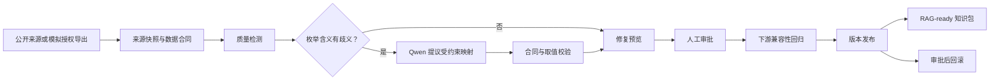
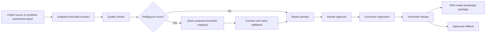

# DataOps Agent | 数据与知识发布治理

## 中文

DataOps Agent 将来源快照、数据合同、质量检测、语义修复、人工审批和下游兼容性回归串成一条版本化发布链路。它面向结构化数据与 RAG-ready 知识更新：候选数据先接受检查和修复预览，只有审批及消费者回归通过后，才切换正式版本；异常候选会被挡在发布前，已发布版本可按审批流程回滚。

**可核查结果：** Qwen 语义规划主链在独立 24 条场景中通过 24 条、审批绕过为 0；公开候选在全新 Python 3.11 环境通过 142 项测试；与医院 Agent 的跨项目演示通过 11/11 项门禁。三组数字分别来自真实模型独立评测、自动化回归和跨项目演示。

### 主链如何运作



模型处理的是按值分组的候选项和合同允许值，不接收整行原始数据。它可以观察修复预览并做一次有限重规划；最终校验、审批、发布和回滚由确定性主链掌握。治理决策记忆仅在同数据集、合同、字段和值的范围内复用已批准映射，命中记忆也必须重新经过本次审批与发布门禁。

### 代码与证据

| 要核查的问题 | 入口 |
| --- | --- |
| 模型是否真实参与语义决策？ | [规划与校验](src/dataops_agent/semantic_planner.py) · [主链测试](tests/test_semantic_agent_mainline.py) · [脱敏真实模型评测](reports/dataops_semantic_planner_p0_eval_20260912_token_plan_full24_v2_enum_meanings_metrics.json) |
| 错误或过期候选能否成为正式版本？ | [版本控制](src/dataops_agent/versioning.py) · [决策记忆](src/dataops_agent/decision_memory.py) · [并发测试](tests/test_concurrency.py) |
| 下游失败是否阻断发布？ | [消费者回归](src/dataops_agent/downstream_regression.py) · [恢复测试](tests/test_cross_project_recovery.py) |
| 如何复现完整流程？ | [独立演示](src/dataops_agent/demo.py) · [跨项目编排](src/dataops_agent/portfolio_demo.py) · [质量工作流](.github/workflows/dataops-quality-gate.yml) |

仓库内的脱敏报告记录了此前真实 Qwen 调用的独立评测。默认本地演示使用隔离样例，不读取密钥，也不在运行时调用模型；两类证据应分别看待。

### 本地运行

需要 Python 3.11 或更新版本。以下是 Windows PowerShell 命令；macOS/Linux 将 `.\.venv\Scripts\python.exe` 换成 `.venv/bin/python`。

```powershell
python -m venv .venv
.\.venv\Scripts\python.exe -m pip install -e ".[dev]"
.\.venv\Scripts\python.exe -m pytest
.\.venv\Scripts\python.exe -m dataops_agent.demo
```

若同时克隆了相邻的 `hospital-service-agent` 仓库并安装其依赖，可运行跨项目演示：

```powershell
.\.venv\Scripts\python.exe -m dataops_agent.portfolio_demo --hospital-repo ..\hospital-service-agent
```

命令会将本轮知识发布报告交给医院 FastAPI 做只读预检，再演练坏候选阻断和审批恢复。它引用固定的脱敏真实模型评测证据，但本次编排不重新调用 Qwen；医院预检不会自动切换检索索引。若医院 Python 环境不在相邻目录，可通过 `HOSPITAL_AGENT_PYTHON` 指定解释器。

### 可选：真实模型复测

在本机环境变量中配置 `DATAOPS_QWEN_API_KEY`，不要提交密钥。评测使用 Qwen Token Plan 的 OpenAI 兼容接口与 `qwen3.7-plus`；先检查配置，再决定是否消耗额度：

```powershell
.\.venv\Scripts\python.exe experiments\semantic_planner_p0_eval\evaluate.py --check-only
.\.venv\Scripts\python.exe experiments\semantic_planner_p0_eval\evaluate.py --max-cases 24 --max-output-tokens 400 --report-prefix dataops_public_live
```

完整评测最多发起 24 次模型调用，每次输出上限 400 token，另有输入 token。模型评测不会自动批准或发布数据。

### 证据范围

公开来源样例保留来源信息；“授权导出”样例是脱敏的合成数据，不代表真实企业数据接入。代码与脱敏报告支持本地复现和审查，但不构成生产流量、业务收益、生产 SLA 或自动生产发布的证据。仓库不包含密钥、私有导出、患者数据或个人求职材料。源码可供审阅；当前未授予开源许可证。

## English

DataOps Agent connects source snapshots, data contracts, quality checks, semantic repair, human approval, and consumer regression into a versioned release workflow. It governs structured data and RAG-ready knowledge updates: candidates are validated and previewed before approval, and the active version changes only after downstream checks pass. Bad candidates are blocked before release; rollback requires approval.

**Verifiable results:** A previous independent 24-case real-Qwen evaluation passed 24/24 with zero approval bypasses. The public candidate passed 142 tests in a fresh Python 3.11 environment. The workflow with Hospital Service Agent passed 11/11 gates. These are separate model-evaluation, automated-test, and integration results.

### How the workflow runs



The planner sees grouped candidate values and allowed contract choices, not whole source rows. It may observe a repair preview and replan once. Deterministic validation and approval retain control of publication and rollback. Decision memory reuses an approved mapping only within the same dataset, contract, field, and value; every new release still passes fresh approval and release gates.

### Code and evidence

| Question | Entry point |
| --- | --- |
| Does the model affect a real decision? | [Planner and validation](src/dataops_agent/semantic_planner.py) · [main-chain tests](tests/test_semantic_agent_mainline.py) · [redacted real-model evaluation](reports/dataops_semantic_planner_p0_eval_20260912_token_plan_full24_v2_enum_meanings_metrics.json) |
| Can a bad or stale candidate become active? | [Versioning](src/dataops_agent/versioning.py) · [decision memory](src/dataops_agent/decision_memory.py) · [concurrency tests](tests/test_concurrency.py) |
| Does downstream failure block release? | [Consumer regression](src/dataops_agent/downstream_regression.py) · [recovery tests](tests/test_cross_project_recovery.py) |
| Can the workflow be reproduced? | [Standalone demo](src/dataops_agent/demo.py) · [two-project orchestration](src/dataops_agent/portfolio_demo.py) · [quality workflow](.github/workflows/dataops-quality-gate.yml) |

The bundled redacted report documents an earlier independent run with real Qwen calls. The default isolated local demo needs no key and makes no model call; these are different forms of evidence.

### Run locally

Use Python 3.11 or newer. These commands target Windows PowerShell; on macOS/Linux replace `.\.venv\Scripts\python.exe` with `.venv/bin/python`.

```powershell
python -m venv .venv
.\.venv\Scripts\python.exe -m pip install -e ".[dev]"
.\.venv\Scripts\python.exe -m pytest
.\.venv\Scripts\python.exe -m dataops_agent.demo
```

With the separate `hospital-service-agent` repository installed beside this one, run the cross-project workflow:

```powershell
.\.venv\Scripts\python.exe -m dataops_agent.portfolio_demo --hospital-repo ..\hospital-service-agent
```

It sends the current knowledge-release report to the hospital FastAPI read-only preflight, then exercises bad-candidate blocking and approved recovery. The workflow references fixed redacted real-model evidence but makes no new Qwen call. Preflight does not automatically switch the hospital search index. Set `HOSPITAL_AGENT_PYTHON` if the hospital interpreter is elsewhere.

### Optional real-model evaluation

Set `DATAOPS_QWEN_API_KEY` locally and never commit it. The evaluator uses the OpenAI-compatible Qwen Token Plan endpoint with `qwen3.7-plus`. Check configuration before spending quota:

```powershell
.\.venv\Scripts\python.exe experiments\semantic_planner_p0_eval\evaluate.py --check-only
.\.venv\Scripts\python.exe experiments\semantic_planner_p0_eval\evaluate.py --max-cases 24 --max-output-tokens 400 --report-prefix dataops_public_live
```

The full run can make up to 24 model calls, each with a 400-output-token cap plus input tokens. Evaluation cannot approve or publish data automatically.

### Evidence boundary

Public-source samples retain provenance. The “authorized export” sample is synthetic and de-identified, not a real enterprise integration. Code and redacted reports support local reproduction and review, not claims about production traffic, business ROI, production SLA, or automatic production release. No keys, private exports, patient records, or personal recruitment materials are included. Source is available for review; no open-source license is granted by default.
