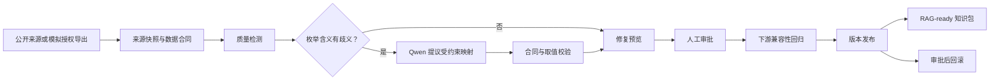
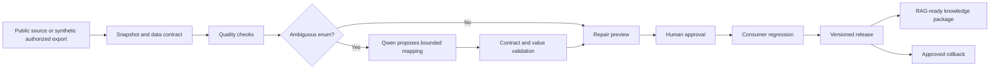

# DataOps Agent | 数据与知识发布治理

## 中文

DataOps Agent 将来源快照、数据合同、质量检测、语义修复、人工审批和下游兼容性回归串成一条版本化发布链路。它面向结构化数据与 RAG-ready 知识更新：候选数据先接受检查和修复预览，只有审批及消费者回归通过后，才切换正式版本；异常候选会被挡在发布前，已发布版本可按审批流程回滚。

这个公开快照只展示 DataOps 核心：来源追溯、候选修复、人工审批、版本发布、消费者回归与回滚。仓库中的公开数据是为复现链路准备的最小样例，不代表授权环境中的完整数据量或求职材料中的评测口径；运行默认流程不依赖其他业务仓库，也不需要模型密钥。

### 五分钟核查重点

| 想确认什么 | 直接运行或查看什么 |
| --- | --- |
| 未审批候选能否绕过发布 | 运行全量测试，查看审批与版本控制用例 |
| 下游不兼容是否会阻断切换 | 运行独立 demo，查看消费者回归与 active version 结果 |
| 发布后如何恢复 | 查看回滚用例与 demo 生成的审计报告 |
| 模型是否拥有审批或写入权限 | 查看语义规划器、工具白名单与安全测试 |

### 主链如何运作



模型处理的是按值分组的候选项和合同允许值，不接收整行原始数据。它可以观察修复预览并做一次有限重规划；最终校验、审批、发布和回滚由确定性主链掌握。治理决策记忆仅在同数据集、合同、字段和值的范围内复用已批准映射，命中记忆也必须重新经过本次审批与发布门禁。

### 代码与证据

| 要核查的问题 | 入口 |
| --- | --- |
| 模型如何参与受约束语义决策？ | [规划与校验](src/dataops_agent/semantic_planner.py) · [主链测试](tests/test_semantic_agent_mainline.py) · [评测入口](experiments/semantic_planner_p0_eval/evaluate.py) |
| 错误或过期候选能否成为正式版本？ | [版本控制](src/dataops_agent/versioning.py) · [决策记忆](src/dataops_agent/decision_memory.py) · [并发测试](tests/test_concurrency.py) |
| 下游失败是否阻断发布？ | [消费者回归](src/dataops_agent/downstream_regression.py) · [消费者测试](tests/test_consumer_integration.py) |
| 如何复现完整流程？ | [独立演示](src/dataops_agent/demo.py) · [质量工作流](.github/workflows/dataops-quality-gate.yml) |

默认本地演示使用隔离样例，不读取密钥，也不在运行时调用模型。仓库中保留的脱敏报告属于对应提交时的工程快照，只用于审查实现，不应当作当前求职指标或生产效果。

### 本地运行

需要 Python 3.11 或更新版本。以下是 Windows PowerShell 命令；macOS/Linux 将 `.\.venv\Scripts\python.exe` 换成 `.venv/bin/python`。

```powershell
python -m venv .venv
.\.venv\Scripts\python.exe -m pip install -e ".[dev]"
.\.venv\Scripts\python.exe -m pytest
.\.venv\Scripts\python.exe -m dataops_agent.demo
```

`pytest` 验证审批、权限、并发、失败恢复和消费者门禁；`dataops_agent.demo` 在隔离运行目录中完成候选检测、审批、发布、下游回归与回滚，并生成 JSON/Markdown 审计结果。成功标准不是某个固定测试数量，而是当前提交的全部测试通过且 demo 最终状态为 `passed`。

### 可选：真实模型复测

在本机环境变量中配置 `DATAOPS_QWEN_API_KEY`，不要提交密钥。评测使用 Qwen Token Plan 的 OpenAI 兼容接口与 `qwen3.7-plus`；先检查配置，再决定是否消耗额度：

```powershell
.\.venv\Scripts\python.exe experiments\semantic_planner_p0_eval\evaluate.py --check-only
.\.venv\Scripts\python.exe experiments\semantic_planner_p0_eval\evaluate.py --max-cases 3 --max-output-tokens 400 --report-prefix dataops_public_smoke
```

第二条命令是小规模连通性复测示例，会发起真实模型调用并产生费用；模型评测不能自动批准或发布数据。需要扩大样本时，应先确定独立评测集、调用预算和验收口径，而不是把示例数量当作项目效果。

### 证据范围

公开来源样例保留来源信息；“授权导出”样例是脱敏的合成数据，不代表真实企业数据接入。公开样例的行数、测试数量和历史报告只描述这个可复现快照，不能反推未公开数据或其他评测集。代码支持本地复现和审查，但不构成生产流量、业务收益、生产 SLA 或自动生产发布的证据。仓库不包含密钥、私有导出、患者数据或个人求职材料。源码可供审阅；当前未授予开源许可证。

## English

DataOps Agent connects source snapshots, data contracts, quality checks, semantic repair, human approval, and consumer regression into a versioned release workflow. It governs structured data and RAG-ready knowledge updates: candidates are validated and previewed before approval, and the active version changes only after downstream checks pass. Bad candidates are blocked before release; rollback requires approval.

This public snapshot deliberately focuses on the DataOps core: provenance, candidate repair, human approval, versioned release, consumer regression, and rollback. Its public data is a minimal reproducible fixture, not the full scale of any authorized environment or recruitment evaluation. The default workflow needs neither another business repository nor a model key.

### Five-minute review

| Question | What to run or inspect |
| --- | --- |
| Can an unapproved candidate bypass publication? | Run the full test suite and inspect approval/versioning cases |
| Does consumer incompatibility block activation? | Run the standalone demo and inspect consumer regression plus active-version state |
| Can a published version be restored safely? | Inspect rollback tests and the demo audit report |
| Can the model approve or write data? | Inspect the semantic planner, tool allowlist, and security tests |

### How the workflow runs



The planner sees grouped candidate values and allowed contract choices, not whole source rows. It may observe a repair preview and replan once. Deterministic validation and approval retain control of publication and rollback. Decision memory reuses an approved mapping only within the same dataset, contract, field, and value; every new release still passes fresh approval and release gates.

### Code and evidence

| Question | Entry point |
| --- | --- |
| How does the model make a bounded semantic decision? | [Planner and validation](src/dataops_agent/semantic_planner.py) · [main-chain tests](tests/test_semantic_agent_mainline.py) · [evaluation entry point](experiments/semantic_planner_p0_eval/evaluate.py) |
| Can a bad or stale candidate become active? | [Versioning](src/dataops_agent/versioning.py) · [decision memory](src/dataops_agent/decision_memory.py) · [concurrency tests](tests/test_concurrency.py) |
| Does downstream failure block release? | [Consumer regression](src/dataops_agent/downstream_regression.py) · [consumer tests](tests/test_consumer_integration.py) |
| Can the workflow be reproduced? | [Standalone demo](src/dataops_agent/demo.py) · [quality workflow](.github/workflows/dataops-quality-gate.yml) |

The default isolated local demo needs no key and makes no model call. Bundled redacted reports are engineering snapshots tied to their corresponding revisions; they support implementation review but are not current recruitment metrics or production results.

### Run locally

Use Python 3.11 or newer. These commands target Windows PowerShell; on macOS/Linux replace `.\.venv\Scripts\python.exe` with `.venv/bin/python`.

```powershell
python -m venv .venv
.\.venv\Scripts\python.exe -m pip install -e ".[dev]"
.\.venv\Scripts\python.exe -m pytest
.\.venv\Scripts\python.exe -m dataops_agent.demo
```

`pytest` covers approval, permissions, concurrency, failure recovery, and consumer gates. `dataops_agent.demo` runs detection, approval, release, consumer regression, and rollback in an isolated runtime and writes JSON/Markdown audit output. Success is defined by all tests for the current revision passing and the demo ending with `passed`, not by a frozen test-count headline.

### Optional real-model evaluation

Set `DATAOPS_QWEN_API_KEY` locally and never commit it. The evaluator uses the OpenAI-compatible Qwen Token Plan endpoint with `qwen3.7-plus`. Check configuration before spending quota:

```powershell
.\.venv\Scripts\python.exe experiments\semantic_planner_p0_eval\evaluate.py --check-only
.\.venv\Scripts\python.exe experiments\semantic_planner_p0_eval\evaluate.py --max-cases 3 --max-output-tokens 400 --report-prefix dataops_public_smoke
```

The second command is a small live-connectivity example and incurs model usage. Evaluation cannot approve or publish data automatically. Before increasing the case count, define an independent evaluation set, budget, and acceptance criteria instead of treating the example count as a project metric.

### Evidence boundary

Public-source samples retain provenance. The “authorized export” sample is synthetic and de-identified, not a real enterprise integration. Public row counts, test counts, and historical reports describe only this reproducible snapshot; they cannot be used to infer non-public datasets or separate evaluation sets. The code supports local reproduction and review, not claims about production traffic, business ROI, production SLA, or automatic production release. No keys, private exports, patient records, or personal recruitment materials are included. Source is available for review; no open-source license is granted by default.
